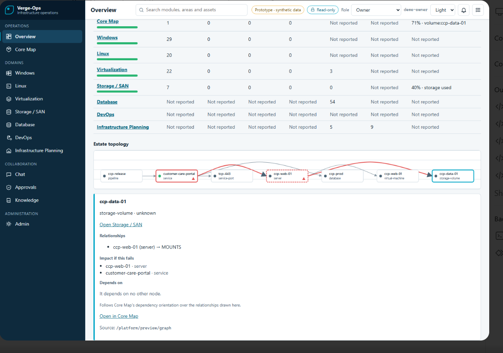

# Verge-Ops

**One evidence-driven workspace for infrastructure operations.**

Verge-Ops is an infrastructure operations platform currently in active development and controlled testing. It is designed to help operations teams understand complex estates, connect evidence across technical domains, and coordinate daily work without replacing the specialist tools they already use.

> **Current status:** Development and controlled testing. Verge-Ops is not yet production released.

## What Verge-Ops brings together

- Windows operations
- Linux operations
- Virtualization operations
- Storage and SAN operations
- Database operations
- DevOps operations
- Infrastructure planning
- Core Map topology and impact analysis
- Collaboration workflows for chat, tasks, approvals, and knowledge

## Core Map

Core Map is the evidence-driven relationship layer of Verge-Ops. Its purpose is to correlate observed relationships between services, hosts, virtual machines, databases, storage, networks, and delivery pipelines.

The design does not invent topology. Relationships must be supported by direct inventory, configuration, service discovery, connection, monitoring, or other attributable evidence.

## Product model

Verge-Ops is being designed around two delivery models:

- **Standalone domains:** a customer can use an individual operations domain independently.
- **Enterprise composition:** multiple domains can operate inside one governed platform with a shared shell, topology, identity, audit, and collaboration services.

The same domain package is intended to serve both models, reducing duplicated development and making future upgrades easier.

## Safety by default

The current prototype uses synthetic data and read-only operation. Governed write actions remain disabled by default while identity, approval, audit, rollback, and action-execution controls are completed and independently tested.

## Current development baseline

- Unified English-language operations shell
- Evidence-based domain inventory and topology
- Standalone and enterprise packaging model
- PostgreSQL-based persistence
- Kong API Gateway foundation
- Policy-controlled action contracts
- Upgrade and rollback contracts
- Synthetic integration simulation
- Deterministic packaging and verification
- Security, mutation, accessibility, and browser testing

## Roadmap

- Persistent Google Cloud integration lab with realistic infrastructure simulations
- OpenTelemetry, Prometheus, Grafana, Loki, and Tempo integrations
- Enterprise monitoring and security connectors
- Expanded database, Storage/SAN, virtualization, and DevOps connector packs
- Network topology and cross-domain impact analysis
- Complete the enterprise integration of governed identity, maker-checker approvals, durable audit, and controlled action execution
- Local offline AI copilot for knowledge retrieval, command assistance, and repeatable runbook automation
- Stress, resilience, vulnerability, and independent cybersecurity testing

## Project principles

1. Evidence before inference.
2. Read-only and fail-closed by default.
3. No invented relationships or hidden authority.
4. Modular domains that can be upgraded independently.
5. The same governed package for standalone and enterprise delivery.
6. Clear separation between simulated, lab-proven, and production-proven capabilities.

## Public repository scope

This repository is a public product overview. It does not contain Verge-Ops application source code, credentials, customer data, internal evidence, private infrastructure details, or production deployment material.

## Contact

**Mohamed Ramadan**  
Infrastructure Operations Manager — Windows, Linux, Storage and SAN

---

Verge-Ops is an independent project in development. Vendor and product names mentioned in roadmap material are compatibility references only and remain the property of their respective owners.

Copyright © 2026 Mohamed Ramadan. All rights reserved.

